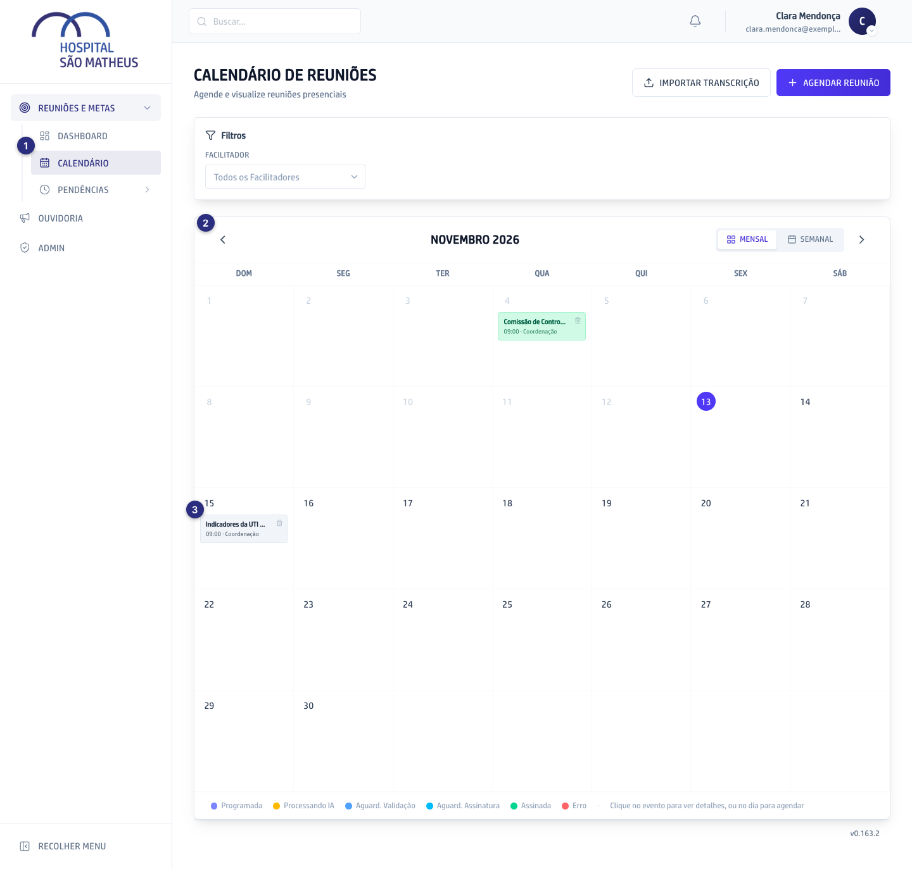
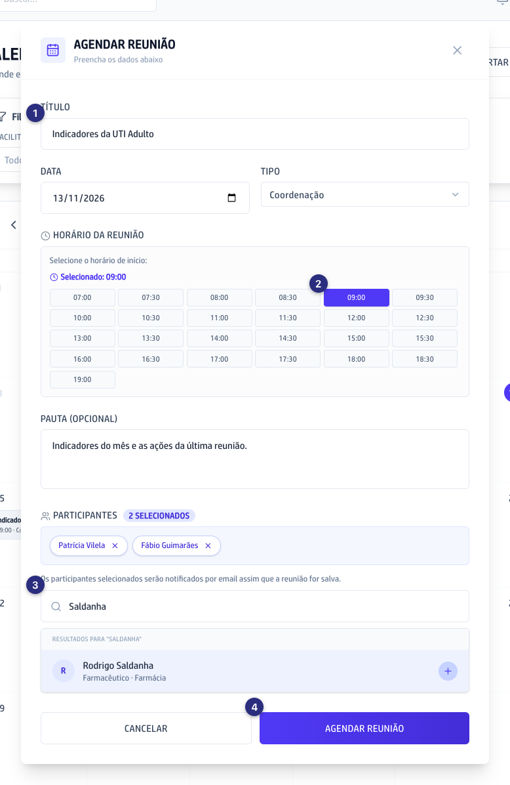
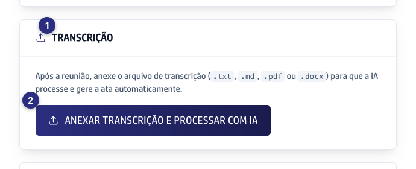
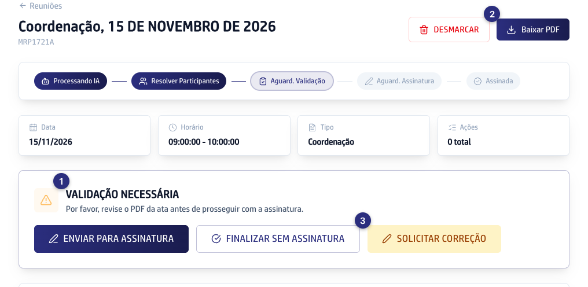
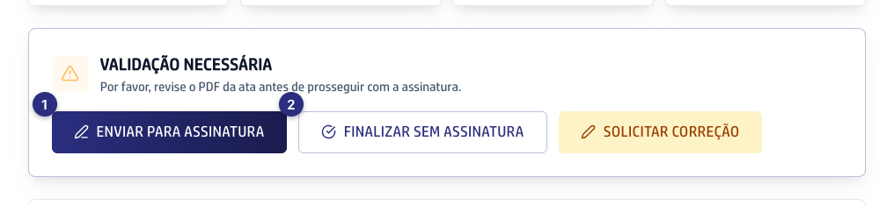
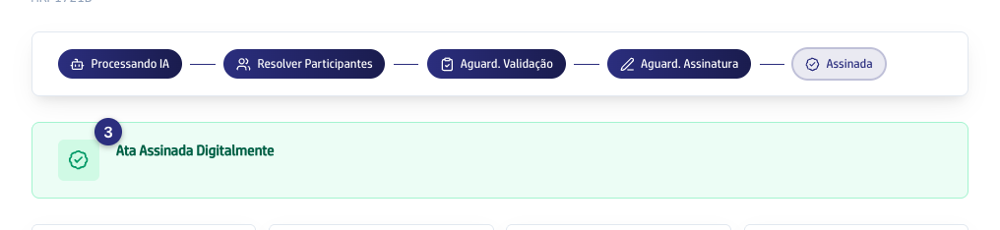
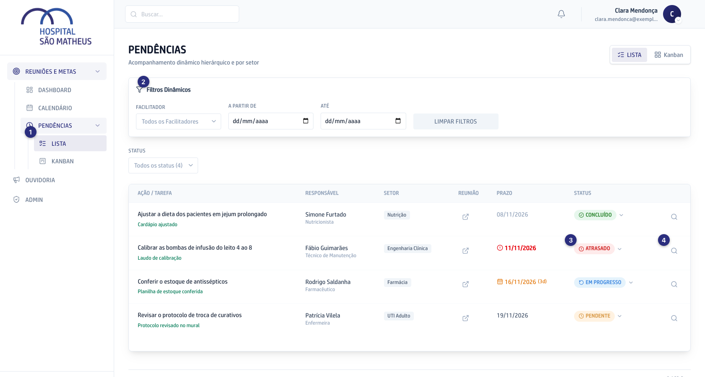

Aqui o hospital marca as reuniões, guarda a Ata de cada uma e acompanha as Pendências que saem delas. Quem conduz a reunião (o Facilitador) marca, anexa a transcrição, revisa a Ata e manda para assinatura. Cada ação combinada vira uma Pendência, com responsável e prazo.

Os números nas imagens mostram onde clicar em cada passo.

## O caminho de uma reunião

Passe o mouse num passo para ver o detalhe, ou clique em **Percorrer** para andar um passo de cada vez.

```fluxograma
inicio marcar 1,1: Marcar a reunião | No Calendário, com data, horário e participantes.
passo transcricao 2,1: Anexar a transcrição | Depois da reunião, o arquivo com o texto do que foi falado.
passo ata 3,1: A IA escreve a Ata | Os assuntos, as decisões e as ações, cada uma com responsável e prazo.
decisao certa 4,1: A Ata está certa?
passo corrigir 4,2: Solicitar correção | Você escreve o que mudar e a IA refaz a Ata.
decisao assinar 5,1: Vai com assinatura?
passo enviar 6,1: Enviar para assinatura | Cada participante recebe um e-mail para assinar.
passo sem 6,2: Finalizar sem assinatura | A Ata fica aprovada na hora, sem assinatura digital.
passo assinada 7,1: Ata assinada | Quem assina já recebe as Pendências dele.
fim pendencias 8,1: Pendências | Cada ação vira uma Pendência, com responsável e prazo.
marcar -> transcricao
transcricao -> ata
ata -> certa
certa -> corrigir: não
corrigir -> ata
certa -> assinar: sim
assinar -> enviar: sim
assinar -> sem: não
enviar -> assinada
assinada -> pendencias
sem -> pendencias
```

## Ver as reuniões do mês

1. No menu da esquerda, abra **Reuniões e metas** e clique em **Calendário** (1).
2. A tela abre no mês de hoje, com as reuniões marcadas em cada dia. A cor do quadradinho mostra em que ponto a reunião está, e a legenda fica embaixo do calendário.
3. Para ir a outro mês, use as setas dos lados do nome do mês (2).
4. Para ver uma semana de cada vez, clique em **Semanal**. **Mensal** volta para o mês inteiro.
5. Clique no nome de uma reunião para abrir a página dela (3).



## Marcar uma reunião

1. No **Calendário**, clique em **Agendar reunião**, no alto à direita. Se preferir, clique direto no dia da reunião: a janela já abre com a data.
2. Escreva o **Título** (1) e confira a **Data**. Escolha o **Tipo** da reunião.
3. Clique no horário de início (2).
4. Se quiser, escreva a **Pauta**, o que vai ser tratado.
5. Em **Participantes**, digite parte do nome de cada pessoa e clique no nome dela na lista (3).
6. Clique em **Agendar reunião** (4). A reunião aparece no Calendário no dia marcado.



## Anexar a transcrição da reunião

A transcrição é o arquivo com o texto do que foi falado na reunião, tirado da gravação. A IA lê esse texto e escreve a Ata.

1. Depois da reunião, abra a página dela pelo **Calendário**.
2. Desça até o quadro **Transcrição** (1).
3. Clique em **Anexar transcrição e processar com IA** (2) e escolha o arquivo no computador. Pode ser `.txt`, `.md`, `.pdf` ou `.docx`.
4. A reunião passa para **Processando IA**. Em alguns minutos a Ata fica pronta e a reunião passa para **Aguard. Validação**.



> Reunião rápida, sem gravação? Use **Iniciar Ata Guiada**, logo abaixo: você conta o que foi tratado numa conversa com o assistente e a Ata se monta na hora.

## Revisar a Ata

Antes de seguir, leia a Ata com calma. Ela vale como registro oficial da reunião.

1. Abra a reunião. No alto aparece o quadro **Validação necessária** (1).
2. Clique em **Baixar PDF** (2) para ver a Ata como ela vai ser assinada.
3. Na própria página, confira os **Participantes**, a **Discussão dos pontos** e o **Quadro de atribuições**. Cada linha do quadro é uma ação, com responsável e prazo.
4. Achou algo errado? Clique em **Solicitar correção** (3), escreva o que precisa mudar e envie. A IA refaz a Ata, e você confere de novo.



## Mandar a Ata para assinatura

1. Com a Ata revisada, escolha um dos dois caminhos no quadro **Validação necessária**.
2. **Enviar para assinatura** (1): o envio sai na hora, sem outra pergunta. Cada participante recebe um e-mail da ClickSign para assinar, e a reunião passa para **Aguard. Assinatura**.
3. **Finalizar sem assinatura** (2): para reuniões do dia a dia, sem assinatura digital. O app pergunta antes, porque não tem volta. Ao confirmar, a Ata fica aprovada e todas as Pendências nascem na hora.
4. Enquanto a Ata espera as assinaturas, a página da reunião mostra quem já assinou. Para cobrar alguém, clique em **Lembrar** na linha da pessoa.
5. Cada pessoa que assina já recebe as Pendências dela. Quando todos assinam, a reunião aparece como **Ata assinada digitalmente** (3).





## Acompanhar as Pendências

1. No menu da esquerda, abra **Pendências** e clique em **Lista** (1).
2. Use os filtros (2) para ver só as Pendências de um Facilitador ou de um período, e o campo **Status** para ver só as atrasadas, por exemplo.
3. Cada linha mostra a ação, o responsável, o setor, o prazo e o status. Prazo em vermelho já venceu.
4. Para mudar o status, clique no selo da coluna **Status** (3) e escolha o novo.
5. Para ver os detalhes, comentar ou marcar alguém com @, clique na lupa no fim da linha (4).
6. Prefere ver em colunas? Clique em **Kanban**, no alto à direita, e arraste o cartão de uma coluna para outra.


