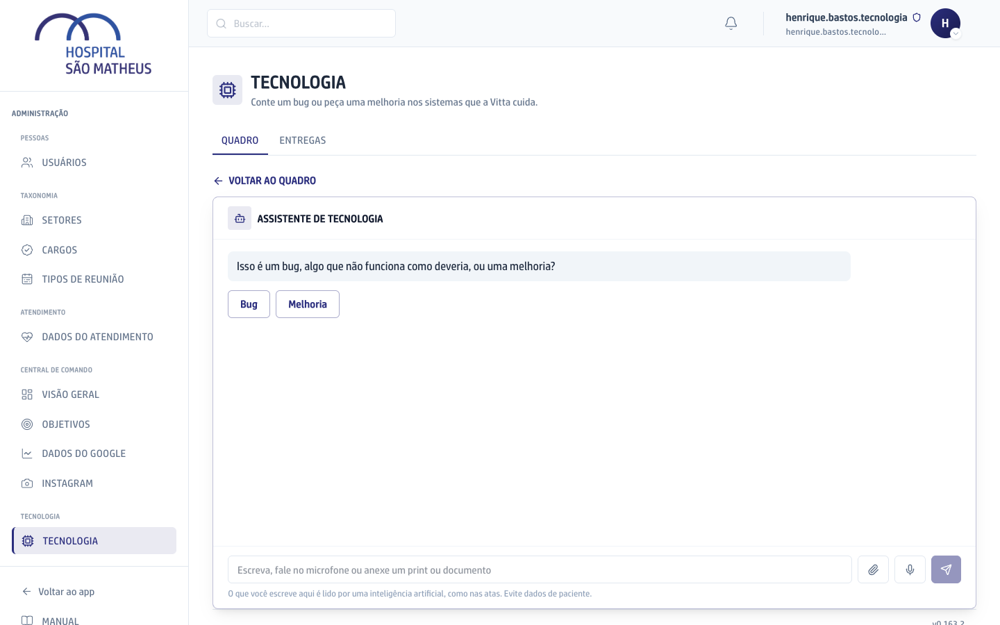
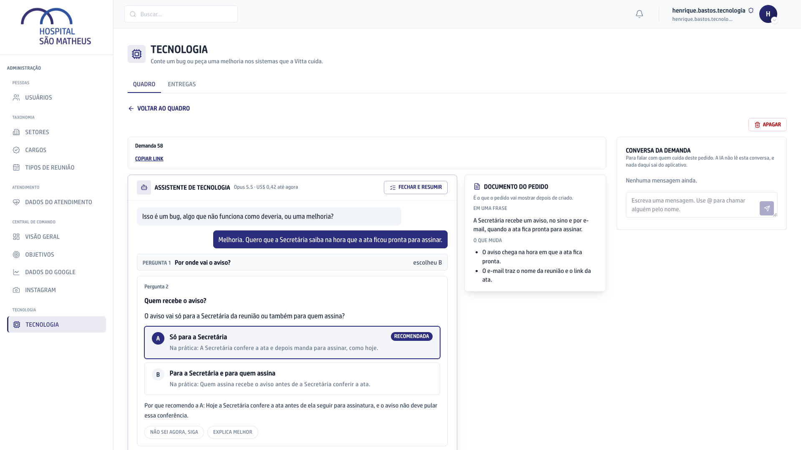
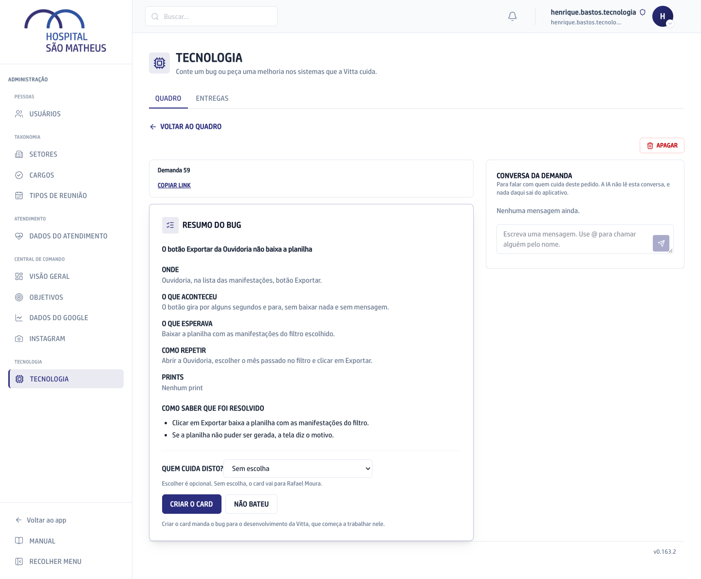
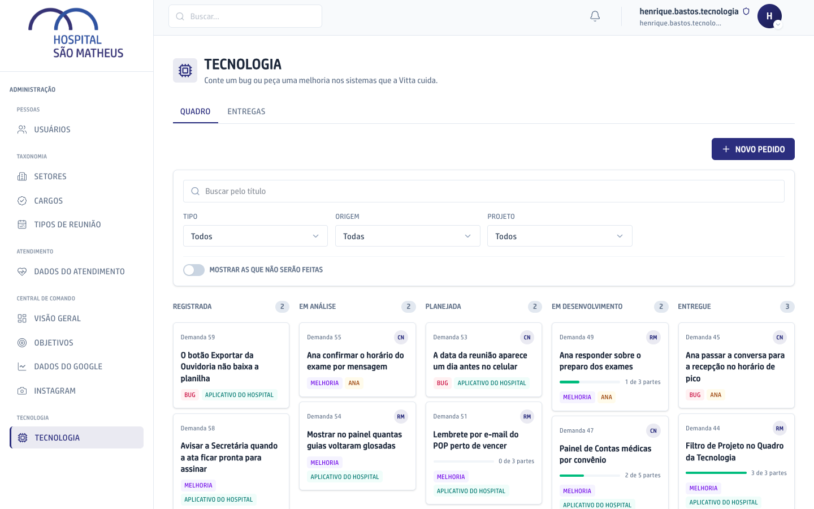
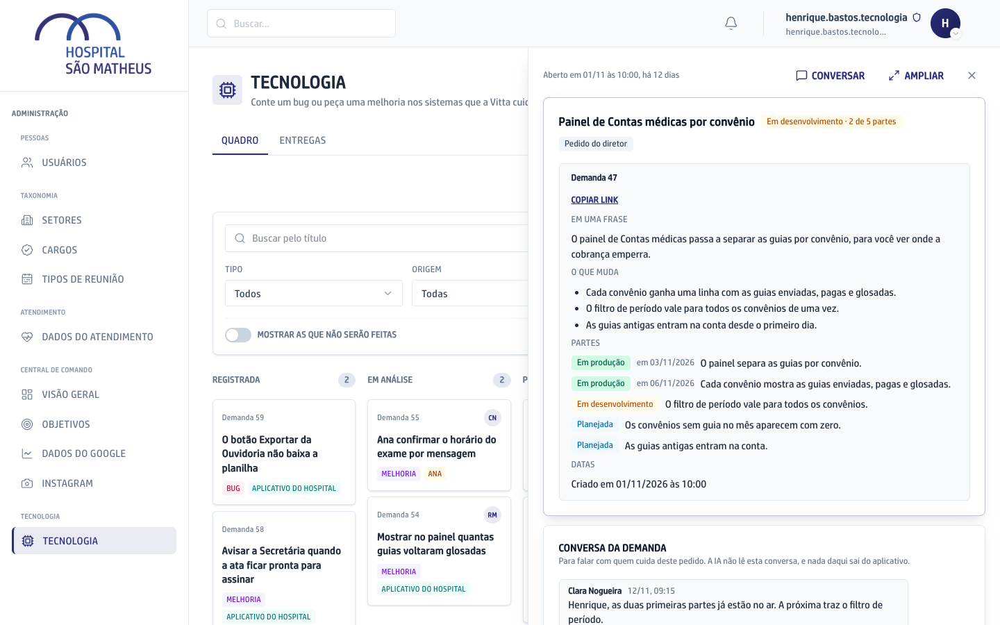
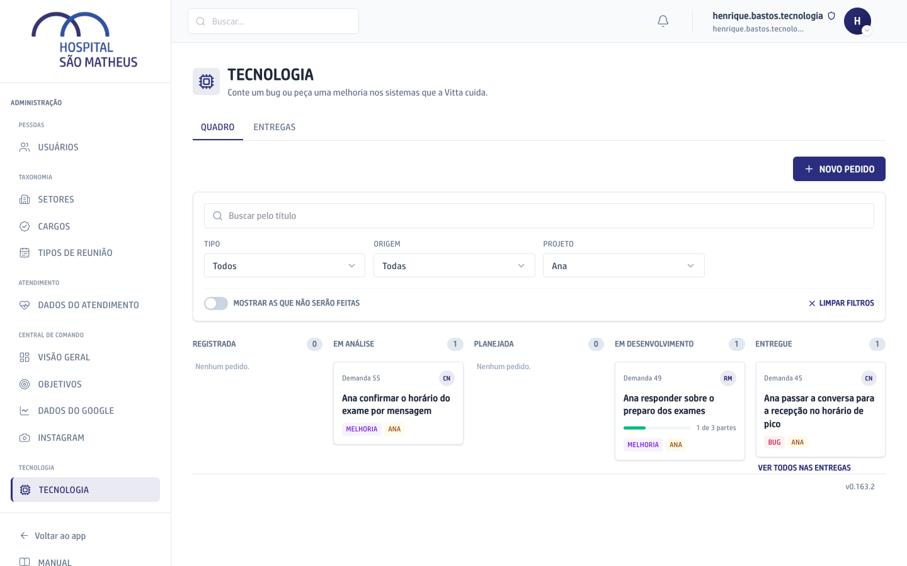
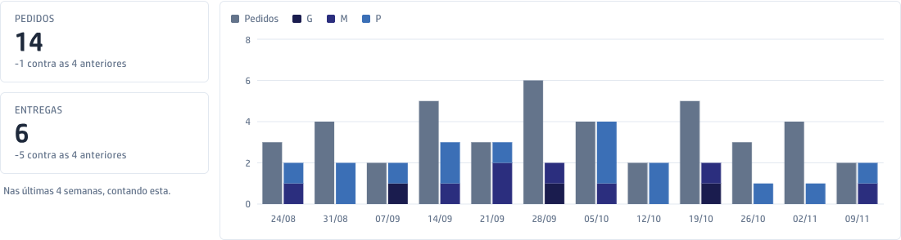
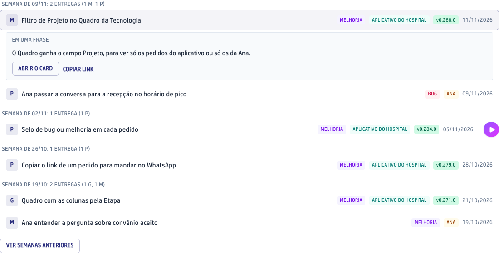

A Tecnologia é onde você conta à Vitta, a empresa que cuida dos sistemas do hospital, um bug ou uma melhoria que quer no aplicativo ou na Ana. Cada pedido vira uma Demanda, que guarda a conversa que a originou, e você acompanha cada uma até a entrega.

Ela fica na área de Administração, e só o Super admin vê. A aba tem duas partes no alto: **Quadro**, com os seus pedidos, e **Entregas**, com o que já foi entregue. No celular, o Quadro se chama **Conversas** e mostra os pedidos numa lista.

## Pedir um bug ou uma melhoria ao Assistente

O Assistente é a IA que entende o seu pedido e o escreve para a Vitta. Nada vai para a Vitta antes do seu clique em **Criar o card**.

1. No menu da esquerda, clique em **Admin**.
2. Na seção **Tecnologia**, clique em **Tecnologia**.
3. No alto da aba, clique em **Novo pedido**. No celular, o botão se chama **Nova conversa**.
4. O Assistente pergunta se é um bug, algo que não funciona como deveria, ou uma melhoria. Clique em **Bug** ou **Melhoria**, ou escreva do seu jeito no campo de baixo. Dá para falar no microfone e anexar um print ou um documento a qualquer momento.

   

5. Responda as perguntas, uma de cada vez. No bug, são no máximo cinco: onde aconteceu, o que aconteceu, o que você esperava, como repetir e o print. Na melhoria, cada pergunta chega num cartão com duas opções; a recomendada vem em destaque, com o porquê embaixo, e a linha **Na prática** diz o que muda com cada uma. Ao lado, o **Documento do pedido** se monta conforme você responde.

   

6. Na melhoria, se quiser encerrar antes, clique em **Fechar e resumir**, no alto da conversa.
7. Leia o resumo. Em **Quem cuida disto?**, escolha quem da Vitta vai cuidar do pedido, se quiser. Sem escolha, o card vai para quem a tela indica.
8. Se o resumo estiver certo, clique em **Criar o card**. Se algo estiver errado, clique em **Não bateu**, diga o quê, e a conversa continua até o resumo ficar certo.

   

Se a conversa parar no meio, ela fica guardada como Registrada. Clique no pedido no Quadro e você continua de onde parou.

## Acompanhar o pedido no Quadro

1. Abra a aba **Tecnologia**. Ela abre no **Quadro**.
2. Veja os seus pedidos em colunas, uma para cada Etapa: Registrada, Em análise, Planejada, Em desenvolvimento e Entregue. A Etapa muda sozinha conforme a Vitta trabalha; não dá para arrastar o card de uma coluna para outra. No alto de cada coluna aparece quantos pedidos ela tem.

   

3. Em cada card, veja o número da Demanda, o título, o selo **Bug** ou **Melhoria**, o Projeto, as iniciais de quem cuida, a versão quando ele já está Em produção e, quando o pedido tem partes, quantas já foram entregues.
4. Clique num card. Ele abre num painel à direita, com o documento do pedido: o que ele muda para você, as partes e as datas.
5. Para falar com a Vitta sobre aquele pedido, clique em **Conversar**, no alto do painel, e escreva na Conversa da Demanda. Para chamar alguém, escreva @ e escolha o nome.

   

6. Para fechar o painel, clique no X ou aperte Esc. O botão **Ampliar** abre o pedido na tela toda, e o **Voltar ao quadro** traz as colunas de volta.

A coluna Entregue mostra o que foi entregue nos últimos 30 dias. Os pedidos que não serão feitos ficam fora das colunas: para vê-los, ligue **Mostrar as que não serão feitas**, na barra de filtros.

## Filtrar por Projeto

A aba junta os pedidos de dois Projetos: o Aplicativo do Hospital e a Ana, a agente de atendimento. Cada card traz um selo com o nome do Projeto.

1. No Quadro, na barra de filtros, clique no campo **Projeto**.
2. Escolha **Aplicativo do Hospital** ou **Ana**. O Quadro passa a mostrar só os pedidos daquele Projeto.

   

3. Para voltar a ver tudo, escolha **Todos** no mesmo campo ou clique em **Limpar filtros**.

O Projeto combina com os outros filtros da barra, o Tipo e a Origem, e com a busca pelo título. Os pedidos da Ana são só para acompanhar: o Assistente cria card apenas no Aplicativo do Hospital. Nas Entregas, o filtro Projeto é a fileira de botões **Todos**, **Aplicativo do Hospital** e **Ana**, no alto.

## Ver as Entregas

1. No alto da aba Tecnologia, clique em **Entregas**.
2. Leia os números do alto: quantos pedidos chegaram e quantas entregas saíram nas últimas 4 semanas, comparados com as 4 anteriores.
3. Veja o gráfico das últimas 12 semanas. Cada barra mostra as entregas da semana pelo tamanho, **P**, **M** ou **G**, conforme o número de partes. Passe o mouse numa barra para ver o que saiu naquela semana. Clique nela para a lista de baixo mostrar só aquela semana.

   

4. Em **O que foi entregue**, veja as entregas agrupadas por semana, a mais nova em cima. Cada linha diz o tamanho, o título, se é bug ou melhoria, a versão e a data.
5. Passe o mouse numa linha, ou clique nela, para ver o que a entrega muda. Ali ficam os botões **Abrir o card** e **Copiar link** e, quando houver vídeo, **Demonstração**.

   

6. No fim da lista, clique em **Ver semanas anteriores** para buscar as entregas mais antigas.

Os filtros do alto, **Bug** ou **Melhoria**, a Origem e o Projeto, valem para os números, para o gráfico e para a lista.

## O caminho de um pedido

```fluxograma
inicio conversa 1,1: Conversa com o Assistente | Você clica em Novo pedido e conta o que precisa, por texto, voz, print ou documento.
decisao tipo 2,1: Bug ou melhoria?
passo bug 3,1: Perguntas do bug | No máximo cinco: onde, o que aconteceu, o que esperava, como repetir e o print.
passo melhoria 3,2: Perguntas da melhoria | Uma por vez, num cartão com duas opções e a recomendada em destaque.
passo resumo 4,1: Resumo | O Assistente junta o que você disse. Em Quem cuida disto?, você escolhe quem da Vitta vai cuidar.
decisao bateu 5,1: O resumo bateu?
passo naobateu 5,2: Não bateu | Você diz o que está errado, e a conversa continua até o resumo ficar certo.
passo card 6,1: Criar o card | O pedido vai para a Vitta e aparece no Quadro.
passo analise 7,1: Em análise | A Vitta lê a melhoria e decide como fazer. O bug pula esta Etapa e entra direto na fila.
passo planejada 7,2: Planejada | O trabalho está dividido em partes e na fila.
passo desenvolvimento 7,3: Em desenvolvimento | A Vitta está fazendo. Num pedido com partes, o card mostra quantas já foram entregues.
fim entregue 7,4: Entregue | O trabalho terminou. Quando a entrega chega ao aplicativo, o card passa a Em produção, com a versão.
conversa -> tipo
tipo -> bug: bug
tipo -> melhoria: melhoria
bug -> resumo
melhoria -> resumo
resumo -> bateu
bateu -> card: sim
bateu -> naobateu: não
naobateu -> resumo
card -> analise: melhoria
card -> planejada: bug
analise -> planejada
planejada -> desenvolvimento
desenvolvimento -> entregue
```
